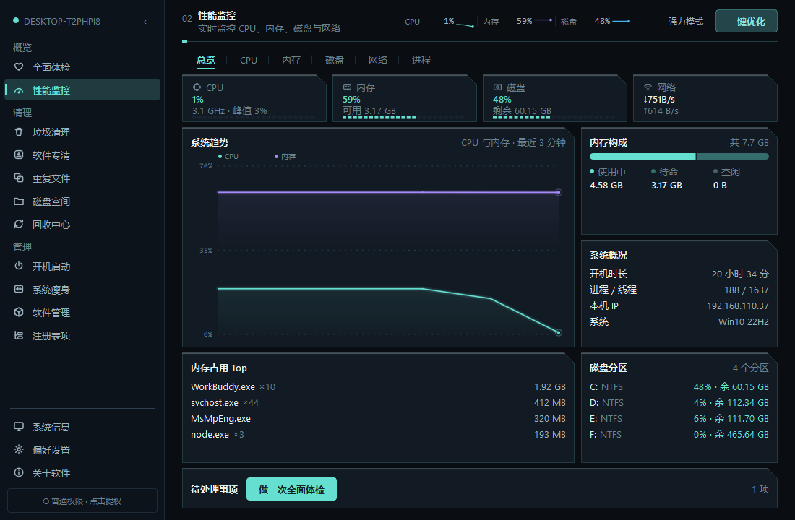

# Windows系统管家

Windows 桌面系统管理工具。PySide6 写的单文件 exe，**纯本地、不联网**。

监控 + 清理 + 体检 + 一键优化，不做系统精简这类高风险操作。

## 功能

| 模块 | 说明 |
|---|---|
| 全面体检 | 11 项加权评分（权重 100），每项可一键跳到对应页处理 |
| 性能监控 | CPU / 内存 / 磁盘 / 网络 / 进程六段，趋势图支持悬停读数 |
| 清理中心 | 四段：常规清理（17 条规则）/ 按软件（微信、QQ、浏览器）/ 重复文件 / 回收站 |
| 重复文件 | 三段式哈希，删除进回收站可还原 |
| 空间分析 | 目录占用 + 可回收项 + 历史快照；大文件**默认扫所有本地磁盘**，可按盘/目录与类型筛，勾选删除到回收站 |
| 开机启动 | 注册表 / 启动文件夹 / 计划任务三处来源一个表，按来源分段，计划任务显示下次运行时间 |
| 系统瘦身 | 9 个系统开关 + 4 项空间回收，每项写明影响，可逐项还原 |
| 软件管理 | 已安装程序（卸载向导退出后自动刷新列表）+ 卸载残留（只列不勾选）+ 注册表残留（强制备份后才允许删除） |
| 系统信息 | SMBIOS 直读，含激活状态、硬件序列号、磁盘健康与通电时间 |
| 一键优化 | 扫垃圾 → 清理 → 整理内存 → 出建议 |

界面：10 项导航，切角面板 + 冷调深色 + 品牌青 `#2DD4BF`，侧栏可收起成图标轨道。
另有可切换的「留白」皮肤（大圆角 + 淡青底），设置 → 外观里一键切回经典。



## 架构

```
UI 层   ui/page_*.py        订阅 store 信号 → 派任务 → 渲染
状态层  core/store.py       单一数据源，apply() 是唯一写入口
编排层  core/task.py        串行任务中心（进度 / 取消 / 失败兜底）
能力层  core/*.py           cleaner / dup / registry / recycle / health / leftover …
公共层  core/syscmd.py      子进程统一封装（隐藏窗口 / 超时 / 解码）
        core/spacemeasure.py  空间项唯一测量源（slim 与 spacereport 共用）
```

一条数据的完整路径：

```
用户点扫描 → tasks.submit("junk", fn) → 串行执行 → 返回 JunkState
→ store.apply → junk_changed 信号 → 清理页/概览页/体检页同时更新
```

**页面不持有业务数据，也不自己起线程。**

入口少的场景用「页内分段」而不是新开导航项：磁盘空间（分析/大文件）、
软件管理（已安装/卸载残留）、性能监控（六段）都是这样。

## 运行

要求：**Windows 10 1809+ / Windows 11**、**Python 3.10+**（实测 3.13.14），
清理系统目录时需要管理员权限。

```bash
python -m venv .venv && .venv\Scripts\activate   # 可选，但建议
pip install -r requirements.txt
python main.py
```

运行时依赖只有 `PySide6-Essentials` 和 `psutil`。

自检（不真删文件，验证数据往返与界面交互）：

```bash
python tools/check_all.py         # 21 个自检脚本一键跑（约 2 分钟）
python tools/check_all.py --headless   # CI 用，17 个；跳过会真装卸/依赖托盘的 3 条
python -m compileall -q core ui main.py
```

## 打包

```bash
python tools/build.py              # 便携版 exe（约 30 MB）+ 归档
python tools/build.py --bump       # PATCH +1 再打包（发新版）
python tools/build_installer.py --build   # 安装包 setup.exe（约 64 MB）
```

产物：`dist/Windows系统管家.exe`（onefile，启动即申请管理员）、
`dist/Windows系统管家-vX.Y.Z-setup.exe`（按用户安装、可卸载）。
本项目只发布 Windows 版，详见 [`docs/打包说明.md`](docs/打包说明.md)。

## 版本与回滚

版本号唯一来源是 `core/version.py`。

```bash
python tools/releases.py              # 列出所有归档版本
python tools/releases.py --to 0.0.37  # 回滚到该版本
```

每次打包会把源码 zip + exe + manifest 存进 `releases/vX.Y.Z/`。
回滚会先把当前状态备份，所以回滚本身也能反悔。

## 安全设计

- **两类删除，界面都写明了**：大文件 / 重复文件 / 卸载残留 / 回收站还原走系统回收站；
  清理中心的临时文件与缓存**直接删除、不进回收站**（都是可再生的，进回收站反而占空间）
- 注册表删除前强制导出 `.reg` 备份，备份失败就取消删除
- 路径保护三道防线（`core/safety.py`），系统目录靠白名单显式放行
- 非管理员时自动跳过需要提权的清理项，避免「扫出来全删不掉」
- 卸载残留是启发式判断：四道闸门过滤 + 只列不勾选 + 删除进回收站，
  详见 [`docs/交接文档.md`](docs/交接文档.md) 6.35

## 出问题时

- 日志在 `%APPDATA%\MemoryKeeper\logs\app.log`（1 MB × 5 份滚动）
- 关于页有「导出诊断信息」：环境摘要 + 日志尾部存成一个文件，路径自动复制
- 读不到数据时界面会明说「读取失败」而不是显示空列表 —— 两者是不同的事

## 文档

- [`docs/交接文档.md`](docs/交接文档.md) —— 架构、设计决策、踩过的坑（**改动前先读**，2500 行）
- [`docs/打包说明.md`](docs/打包说明.md) —— Windows 便携版/安装包、签名与 CI
- [`docs/待接入排查与下步方案.md`](docs/待接入排查与下步方案.md) —— 未完成项与优先级
- [`docs/整改方案.md`](docs/整改方案.md) —— 2026-11-08 的重构路线图（**历史快照**，顶部有现状校准）
- [`docs/GrClean调研与整合方案.md`](docs/GrClean调研与整合方案.md) / [`docs/C盘扫描加强方案.md`](docs/C盘扫描加强方案.md) —— 专项调研（历史方案，顶部有现状校准）

## 推送代码

本机的 HTTP 代理对 `github.com` 一律返回 502，**直连 `git push` 必失败**。
仓库已配好走本机 SOCKS5（v2ray / clash 之类），`git push` 直接可用：

```bash
git config --local http.proxy        # 应为 socks5h://127.0.0.1:10808
git push origin main
```

SOCKS5 没开（推上去会 502）时，去掉仓库级配置改走 REST API：

```bash
git config --local --unset http.proxy
set GH_TOKEN=ghp_xxx
python tools/push_github.py --repo jtnetcc/windows-manager -m "feat: xxx"
```

## 当前版本

v0.0.62 · 内测（版本号唯一来源：`core/version.py`）
