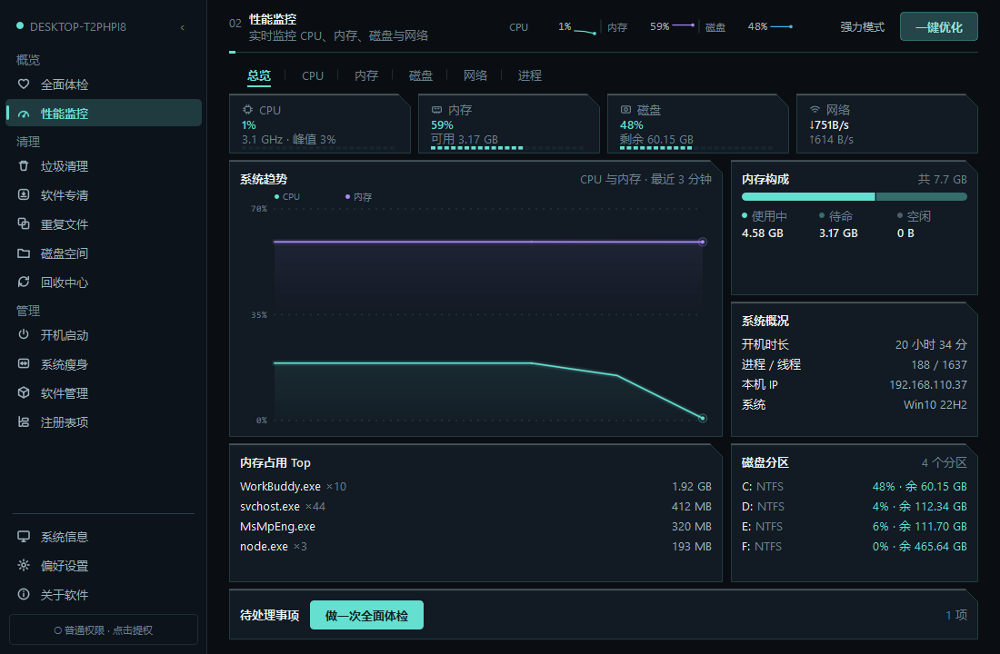

# Windows系统管家

Windows 桌面系统管理工具。PySide6 写的单文件 exe，**纯本地、不联网**。

监控 + 清理 + 体检 + 一键优化，不做系统精简这类高风险操作。

## 功能

| 模块 | 说明 |
|---|---|
| 全面体检 | 11 项加权评分（权重 100），每项可一键跳到对应页处理 |
| 性能监控 | CPU / 内存 / 磁盘 / 网络 / 进程六段，趋势图支持悬停读数 |
| 垃圾清理 | 规则按机器实际存在的目录生成，含社交缓存（微信/QQ/企业微信/钉钉，默认不勾选） |
| 软件专清 | 按软件聚合缓存，拆成图片/视频/文件/表情/缓存，逐类勾选 |
| 重复文件 | 三段式哈希，删除进回收站可还原 |
| 磁盘空间 | 两段：空间分析（目录占用 + 可回收项 + 历史快照）/ 大文件（范围与类型可选） |
| 回收中心 | 列表 / 按体积排序 / 还原 / 清空 |
| 开机启动 | 注册表 / 启动文件夹 / 计划任务三处来源一个表，按来源分段，计划任务显示下次运行时间 |
| 系统瘦身 | 9 个系统开关 + 4 项空间回收，每项写明影响，可逐项还原 |
| 软件管理 | 已安装程序（可卸载 / 打开目录）+ **卸载残留**（只列不勾选） |
| 注册表项 | 4 类失效条目，**强制备份后**才允许删除 |
| 系统信息 | SMBIOS 直读，含激活状态、硬件序列号、磁盘健康与通电时间 |
| 一键优化 | 扫垃圾 → 清理 → 整理内存 → 出建议 |

界面：14 项导航，切角面板 + 冷调深色 + 品牌青 `#2DD4BF`，侧栏可收起成图标轨道。



## 架构

```
UI 层   ui/page_*.py        订阅 store 信号 → 派任务 → 渲染
状态层  core/store.py       单一数据源，apply() 是唯一写入口
编排层  core/task.py        串行任务中心（进度 / 取消 / 失败兜底）
能力层  core/*.py           cleaner / dup / registry / recycle / health / leftover …
```

一条数据的完整路径：

```
用户点扫描 → tasks.submit("junk", fn) → 串行执行 → 返回 JunkState
→ store.apply → junk_changed 信号 → 清理页/概览页/体检页同时更新
```

**页面不持有业务数据，也不自己起线程。**

入口少的场景用「页内分段」而不是新开导航项：磁盘空间（分析/大文件）、
软件管理（已安装/卸载残留）、性能监控（六段）都是这样。

## 运行

```bash
pip install -r requirements.txt
python main.py
```

依赖只有 `PySide6-Essentials` 和 `psutil`。

## 打包

```bash
python tools/build.py            # 用当前版本打包 + 归档
python tools/build.py --bump     # PATCH +1 再打包（发新版）
```

产物 `dist/Windows系统管家.exe`（约 37 MB，onefile，启动即申请管理员）。

## 版本与回滚

版本号唯一来源是 `core/version.py`。

```bash
python tools/releases.py              # 列出所有归档版本
python tools/releases.py --to 0.0.37  # 回滚到该版本
```

每次打包会把源码 zip + exe + manifest 存进 `releases/vX.Y.Z/`。
回滚会先把当前状态备份，所以回滚本身也能反悔。

## 安全设计

- 文件删除一律走回收站，不直接 `rm`
- 注册表删除前强制导出 `.reg` 备份，备份失败就取消删除
- 路径保护三道防线（`core/safety.py`），系统目录靠白名单显式放行
- 非管理员时自动跳过需要提权的清理项，避免「扫出来全删不掉」
- 卸载残留是启发式判断：四道闸门过滤 + 只列不勾选 + 删除进回收站，
  详见 [`docs/交接文档.md`](docs/交接文档.md) 6.35

## 出问题时

- 日志在 `%APPDATA%\MemoryKeeper\logs\app.log`（1 MB × 5 份滚动）
- 关于页有「导出诊断信息」：环境摘要 + 日志尾部存成一个文件，路径自动复制
- 读不到数据时界面会明说「读取失败」而不是显示空列表 —— 两者是不同的事

## 文档

- [`docs/交接文档.md`](docs/交接文档.md) —— 架构、设计决策、踩过的坑（改动前先读）
- [`docs/待接入排查与下步方案.md`](docs/待接入排查与下步方案.md) —— 未完成项与优先级
- [`docs/整改方案.md`](docs/整改方案.md) —— 重构路线图

## 推送代码

本机 `github.com` 被代理拦断，`git push` 不可用，改走 REST API：

```bash
set GH_TOKEN=ghp_xxx
python tools/push_github.py --repo jtnetcc/windows-manager -m "feat: xxx"
```

## 当前版本

v0.0.39 · 内测
